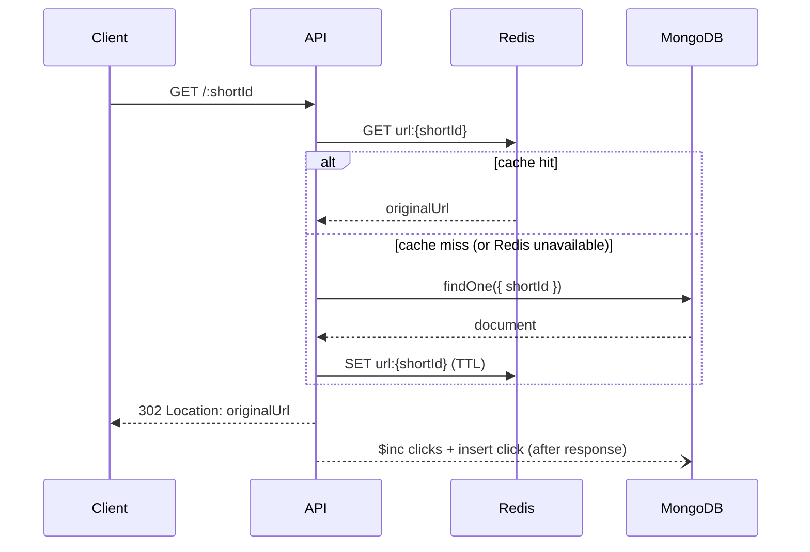

# Pathly

A URL shortener with click analytics. Create short links (optionally with a custom alias or an expiry date), share them, and see how many clicks each one gets per day.

**Live:** https://pathly-delta.vercel.app

**Stack:** Node.js · TypeScript · Express 5 · MongoDB (Mongoose) · Redis · React · Vite · Tailwind CSS · Vitest

## Features

- **Short links** with 7-character Nanoid IDs
- **Custom aliases** such as `/my-portfolio`
- **Expiring links**, removed automatically by a MongoDB TTL index
- **Click analytics**: total clicks and clicks per day, computed with an aggregation pipeline
- **Redis cache** on the redirect path
- **Rate limiting** backed by Redis, so limits hold across multiple instances
- **Graceful degradation**: if Redis is down or not configured, redirects fall back to MongoDB and rate limits fall back to in-memory counters

## Architecture

```
backend/src
├── server.ts          # startup: connect MongoDB/Redis, listen, graceful shutdown
├── app.ts             # Express app factory (middleware, routes, error handling)
├── config/            # env validation (zod) and MongoDB connection
├── routes/            # URL → controller mapping
├── controllers/       # HTTP layer: parse request, call service, send response
├── services/          # business logic and the Redis cache
├── schemas/           # zod request schemas
├── models/            # Mongoose models and indexes
├── middleware/        # rate limiting, error handling
└── lib/               # logger, Redis client, error types
```

The app, services and cache receive their dependencies (such as the Redis client) as arguments instead of creating them, so tests can run against an in-memory database and a mock Redis.

### Redirect flow



## Design decisions

- **302, not 301.** Browsers cache 301 redirects and skip the server on repeat visits, so those clicks would never be counted.
- **Analytics are written after the redirect is sent.** The user doesn't wait on database writes. The trade-off is that a click could be lost if the process crashes in between; a queue such as BullMQ would make this durable.
- **Atomic `$inc` for click counts.** Reading the count, adding one and saving loses updates under concurrent clicks. `$inc` does the increment inside MongoDB. A test sends 20 concurrent clicks and checks that all 20 are counted.
- **Collision handling.** The unique index on `shortId` is what guarantees uniqueness. On a duplicate-key error the service retries with a new ID, up to 5 times.
- **Expiry is enforced twice.** MongoDB's TTL monitor runs about once a minute, so an expired link can exist briefly. The service checks `expiresAt` on every lookup, and cache entries never live longer than the link's expiry.
- **Redis failures don't take the API down.** The client fails fast instead of queueing commands, so cache errors are treated as cache misses and the rate limiter lets requests through.
- **Configuration is validated at startup.** A missing or invalid env var stops the process immediately with a clear message.

## API

| Method | Path | Description |
|---|---|---|
| `POST` | `/api/shorten` | Create a short link |
| `GET` | `/:shortId` | Redirect to the original URL (302) |
| `GET` | `/api/analytics/:shortId` | Total clicks and clicks per day |
| `GET` | `/health` | 200 when the database is connected, 503 otherwise |

**Create a link**

```http
POST /api/shorten
Content-Type: application/json

{
  "originalUrl": "https://example.com/some/long/path",
  "customAlias": "my-link",
  "expiresAt": "2026-12-31T23:59:59Z"
}
```

`customAlias` and `expiresAt` are optional. The response is `201` for a new link, or `200` if a permanent link to the same URL already exists. Errors return `{ "error": "message" }` with:

| Status | When |
|---|---|
| `400` | Invalid URL (only `http`/`https` are accepted), invalid or reserved alias, expiry in the past |
| `404` | Short ID not found or expired |
| `409` | Alias already taken |
| `429` | Rate limit exceeded |

**Analytics response**

```json
{
  "totalClicks": 42,
  "clicksOverTime": [
    { "_id": "2026-10-21", "count": 17 },
    { "_id": "2026-10-22", "count": 25 }
  ]
}
```

## Running locally

Requirements: Node.js 20.19+ and MongoDB. Redis is optional.

```bash
# Optional: start Redis
docker run -d -p 6379:6379 redis:7

# Backend
cd backend
cp .env.example .env    # set MONGODB_URI (and REDIS_URL if using Redis)
npm install
npm run dev             # http://localhost:3124

# Frontend
cd frontend
echo "VITE_API_BASE_URL=http://localhost:3124" > .env
npm install
npm run dev
```

All backend configuration options are listed in [`backend/.env.example`](backend/.env.example).

## Tests

```bash
cd backend
npm test
```

Integration tests use Vitest and Supertest against an in-memory MongoDB (`mongodb-memory-server`), so no external services are needed. They cover validation, aliases, expiry, redirects, concurrent click counting, short ID collisions, caching (including Redis failure) and rate limiting.

## Scripts (backend)

| Command | Description |
|---|---|
| `npm run dev` | Start with hot reload |
| `npm run build` | Compile TypeScript to `dist/` |
| `npm start` | Run the compiled server |
| `npm test` | Run the test suite |
| `npm run typecheck` | Type-check without building |
